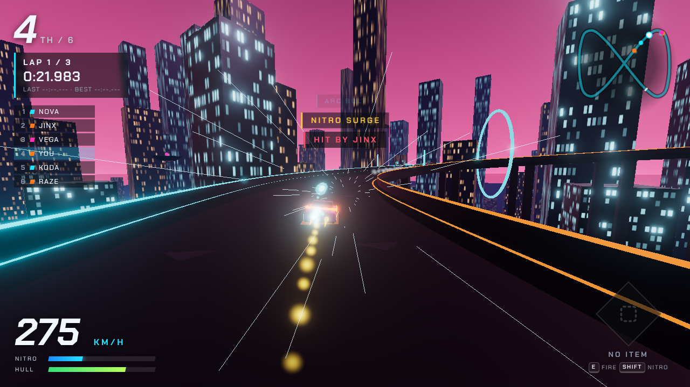
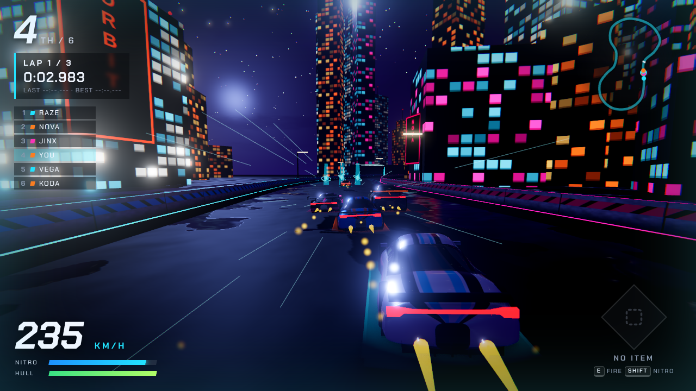
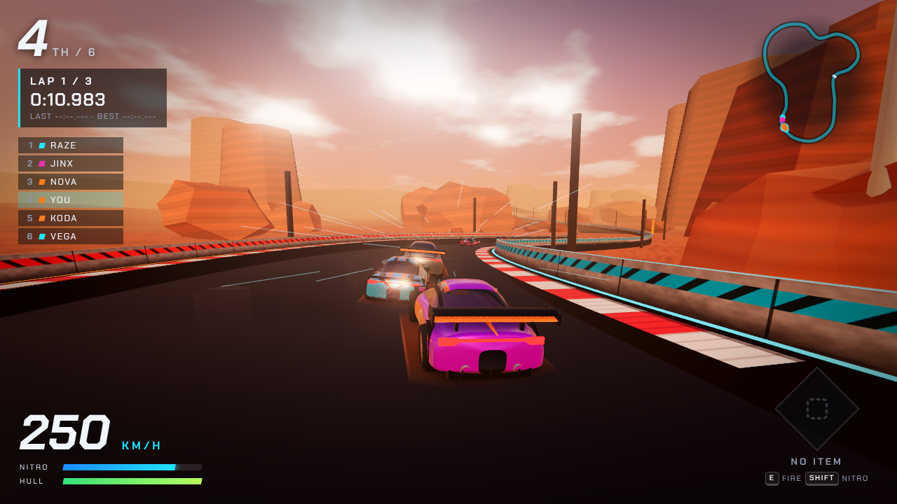
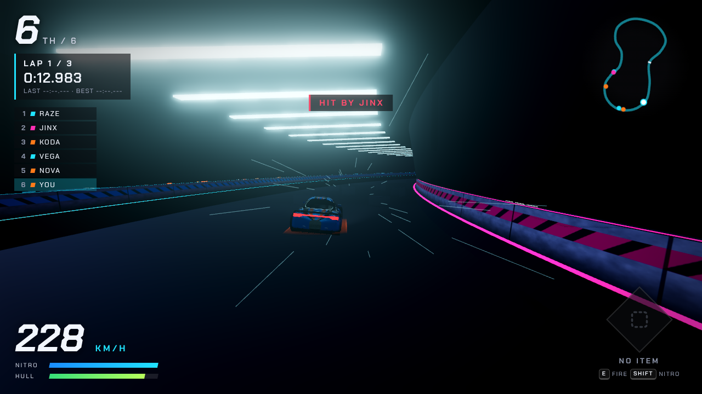
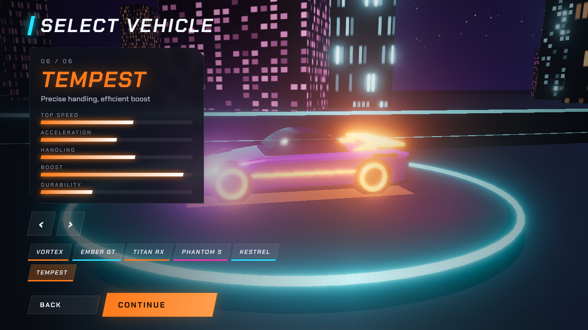
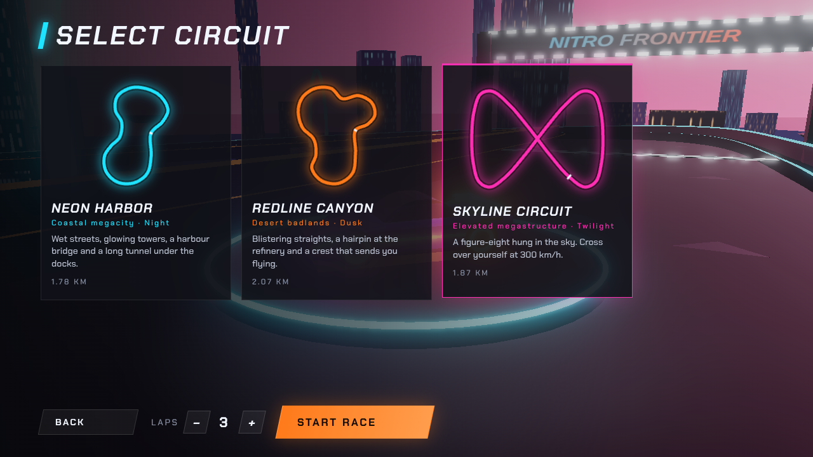

# NITRO FRONTIER

**An original 3D arcade combat racing game that runs in your browser.**
Six fictional cars, three hand-shaped circuits, six energy weapons, five AI rivals with distinct personalities, and four game modes — built from scratch with TypeScript, Three.js and the Web Audio API. No paid services, no API keys, no downloaded assets: every model, texture, sound and music track is generated in code.



| Neon Harbor | Redline Canyon |
|---|---|
|  |  |

| Neon Harbor tunnel | |
|---|---|
|  | |

| Vehicle select | Circuit select |
|---|---|
|  |  |

---

## Features

**Racing**
- Responsive arcade handling: speed-sensitive steering, handbrake drifting (drifts refill nitro), nitro boost, jump ramps with real airtime, boost pads.
- Solid road and barrier collision — cars cannot fall through the track or escape the walls (verified by automated tests for every car on every track).
- Car-to-car collisions with mass-based impulses, automatic and manual (`R`) recovery.
- Checkpoint-validated laps: driving backwards or cutting across never counts.

**Combat** — six original power-ups, collected from pickups on the track:

| Power-up | Effect |
|---|---|
| **ARC BOLT** | Fast energy bolt that rides the road in the lane you fired it from. |
| **PHASE SHIELD** | Blocks every attack for 6 seconds. |
| **PULSE WAVE** | Short-range shockwave that shoves and damages nearby rivals. |
| **SEEKER DRONE** | Guided drone that hunts the rival directly ahead of you. |
| **NITRO SURGE** | A huge burst of speed. |
| **GRAVITY SNARE** | Drops a field behind you that drags rivals to half speed. |

Racers further back receive more catch-up items, so combat rewards positioning rather than pure luck. Hulls take damage; a wrecked car explodes and respawns after a short delay.

**AI** — five opponents per race with four driving styles (aggressive, defensive, balanced, speed). They follow a pre-computed racing line, plan their braking for upcoming corners, avoid each other, detour for pickups, use nitro on straights, raise shields against incoming fire and recover when stuck. They never teleport or skip checkpoints; a mild, invisible catch-up keeps races close.

**Game modes**
- **Quick Race** — any car, any circuit, 1–5 laps, six racers.
- **Championship** — three races across all circuits, points per finish (10-8-6-5-4-3), standings between rounds.
- **Time Trial** — solo, no weapons (only Nitro Surge and Phase Shield spawn). Best times are saved.
- **Practice** — endless laps with passive training drones. Keys `1`–`6` equip any power-up to try it.

**Worlds**
- **Neon Harbor** — a night-time coastal megacity with a tunnel under the docks and a harbour jump.
- **Redline Canyon** — desert badlands at dusk, with mesas, a refinery hairpin and two jumps.
- **Skyline Circuit** — a figure-eight suspended in the sky that crosses over itself.

**Presentation** — sculpted procedural cars with racing liveries, detailed rims and brake calipers; a live reflection probe so cars and wet asphalt mirror their real surroundings; MSAA anti-aliasing, ambient occlusion, bloom and colour grading; textured asphalt with wet patches, red/white kerbs, concrete walls, skyscrapers with real-scale windows, layered canyon rock, procedural clouds and stars, particle sparks/smoke/dust/explosions, speed lines, FOV kick, camera shake, three camera modes, a fully procedural synth soundtrack and engine/tyre/wind audio, animated menus with a 3D showroom, HUD with minimap and live leaderboard.

---

## Requirements

- **Node.js 22.12 or newer** (includes npm). Check with `node -v`.
- A modern desktop browser with WebGL: **Chrome, Chromium or Firefox** on Linux, Windows or macOS.

On Ubuntu, the easiest way to get a current Node.js is [nvm](https://github.com/nvm-sh/nvm):

```bash
curl -o- https://raw.githubusercontent.com/nvm-sh/nvm/v0.40.3/install.sh | bash
source ~/.bashrc
nvm install 22
```

## Installation

```bash
git clone https://github.com/<your-username>/nitro-frontier.git
cd nitro-frontier
npm install
```

### Optional: AI-generated 3D car models

Six 3D car bodies were generated for this game with [Higgsfield](https://higgsfield.ai) (concept images with *Z Image*, converted to 3D with *SAM 3 3D Objects*). They are not stored in the repository; download them into `public/models/` with:

```bash
npm run models
```

The script downloads each model and registers it in `public/models/manifest.json`. Cars whose model is missing simply keep their built-in procedural body, so the game always works.

When a model is loaded, the game automatically turns its longest side to face the driving direction, scales it to the car's real length and puts it on the ground. If a car ends up **facing backwards**, set `"flip": true` for it in `public/models/manifest.json` (or fine-tune with `"yawDegrees"`). Other options: `"hideWheels": false` keeps the spinning procedural wheels, `"scale"` adjusts size, `"tint": "#rrggbb"` recolours the model.

You can use your own GLB models the same way: drop `<car-id>.glb` into `public/models/` and add a line to the manifest. Car ids are `vortex`, `ember`, `titan`, `phantom`, `kestrel` and `tempest`.

## Development

```bash
npm run dev
```

Then open the URL Vite prints (usually <http://localhost:5173>).

## Production build

```bash
npm run build      # type-checks, then builds into dist/
npm run preview    # serves dist/ locally to try the production build
```

The build uses relative paths (`base: './'`), so the contents of `dist/` can be uploaded as-is to **GitHub Pages, Netlify, Vercel, itch.io** or any static host — including a sub-folder.

### Deploying to GitHub Pages (one way)

```bash
npm run build
npx gh-pages -d dist
```

Then enable Pages for the `gh-pages` branch in your repository settings.

## Tests

```bash
npm test           # run once
npm run test:watch # watch mode
npm run typecheck  # TypeScript only
```

The unit tests (Vitest) cover checkpoint progression, lap counting and anti-cheat (no reversing over the line), race ranking, championship scoring, power-up rules and cooldowns, the game-state machine, save-data validation, track geometry (spacing, crossing heights), vehicle physics (top speed, steering direction, braking/reverse, nitro) and wall containment for every car on every track.

---

## Controls

| Key | Action |
|---|---|
| `W` / `↑` | Accelerate |
| `S` / `↓` | Brake / reverse |
| `A` `D` / `←` `→` | Steer |
| `Space` | Handbrake drift |
| `Shift` | Nitro boost |
| `E` | Fire power-up |
| `R` | Recover car |
| `C` | Change camera (chase / far / hood) |
| `M` | Mute |
| `Esc` | Pause / back |
| `1`–`6` | Equip a power-up (Practice only) |

In menus: mouse, or `Enter` on the title screen and `←` `→` on vehicle select.

---

## Project structure

```
src/
  main.ts                 Boot: WebGL check, loader, error screen
  config/GameConfig.ts    All tunable gameplay numbers in one place
  game/
    Game.ts               Top-level controller: menus ↔ races, settings, saves
    GameState.ts          Finite-state machine with whitelisted transitions
    GameLoop.ts           Single requestAnimationFrame loop (idempotent start/stop)
    RaceManager.ts        One race: spawning, physics steps, laps, combat hooks, results
    RaceResults.ts        Results, championship points, formatting
    Showroom.ts           3D backdrop behind the menus
  rendering/
    Renderer.ts           WebGL renderer, bloom, quality tiers, adaptive resolution
    Lighting.ts           Sun + sky light with a following shadow frustum
    CameraController.ts   Chase / far / hood cameras, lag, look-ahead, shake, FOV
    Effects.ts            Pooled GPU particles, shock rings, speed lines
    ReflectionProbe.ts    Live cube-map reflections of the surroundings
  vehicles/
    VehicleConfig.ts      The six cars and their stats
    VehiclePhysics.ts     Arcade physics: grip, drift, nitro, walls, airtime
    Vehicle.ts            A racer: physics + model + race/combat state
    CarModel.ts           Procedural car meshes
    CarAssets.ts          Loads optional GLB car models and auto-aligns them
    PlayerController.ts   Keyboard input (never sticks on blur/pause)
  ai/
    AIDriver.ts           Steering, braking, avoidance, pickups, weapon tactics
    RacingLine.ts         Pre-computed racing line and corner speeds
  tracks/
    Track.ts              Spline sampling and fast nearest-point queries
    TrackRegistry.ts      The three circuit definitions
    TrackFactory.ts       Procedural road, kerbs, barriers, tunnels, scenery
    Materials.ts          Procedural textures: asphalt, kerbs, concrete, facades, rock, sand
    CheckpointSystem.ts   Lap/checkpoint progress and ranking
  combat/
    PowerUp.ts            Power-up definitions and the weighted roll
    WeaponSystem.ts       Pickups, projectiles, shields, pulses, snares
    Projectile.ts         Pooled projectile meshes
  ui/                     Menus, HUD, results — plain DOM, no framework
  audio/AudioManager.ts   Synthesised engine, SFX and music (Web Audio)
  storage/SaveManager.ts  localStorage saves with validation and fallbacks
  styles/main.css
tests/                    Vitest unit tests
```

## Extending the game

**Add a vehicle** — append an entry to `VEHICLES` in `src/vehicles/VehicleConfig.ts`. Stats (`maxSpeed`, `acceleration`, `grip`, `boostPower`, `durability`…) drive the physics; `shape` drives the procedural model (length, cabin size, spoiler type, fins). It appears in vehicle select automatically and the AI can use it.

**Add a track** — append a `TrackDefinition` to `TRACKS` in `src/tracks/TrackRegistry.ts`: control points `[x, y, z]` for a closed loop, width, scale, tunnel ranges, pickup rows, boost pads, jumps (all as fractions 0–1 of the lap), a scenery kind and a colour theme. Run `npm test` — the geometry tests will flag tight overlaps or bad spacing. Keep corner radii comfortably larger than the road width.

**Add a power-up** — add the type to `PowerUpType`, `POWERUPS` and `POWERUP_ORDER` in `src/combat/PowerUp.ts` (plus its roll weight), implement it in the `switch` in `WeaponSystem.activate`, teach `AIDriver.shouldFire` when to use it, and give it an icon in `powerUpIcon` (`src/ui/dom.ts`) and a sound in `AudioManager.play`.

**Tune balance** — almost every number lives in `src/config/GameConfig.ts`, `WEAPON_STATS` in `WeaponSystem.ts`, or `AI_STYLES` in `AIDriver.ts`.

---

## Troubleshooting

| Problem | Fix |
|---|---|
| “WebGL is not available” | Enable hardware acceleration (Chrome: *Settings → System*; Firefox: *Settings → Performance*), update graphics drivers, check `chrome://gpu` or `about:support`. |
| Low frame rate | Settings → Graphics *Low* or *Medium*, lower Render scale. The game also lowers internal resolution automatically if frames get slow. |
| No sound | Browsers only allow audio after you click or press a key — do that once. Check the volume sliders and that `M` (mute) is off. |
| `npm install` fails / “Unsupported engine” | Upgrade Node.js to 22.12+ (`nvm install 22`). |
| Port 5173 already in use | `npm run dev -- --port 3000` |
| Blank page after deploying | Upload the *contents* of `dist/`, not the project folder. |
| A downloaded car faces backwards | Set `"flip": true` for that car in `public/models/manifest.json` and reload. |
| `npm run models` fails | Check your internet connection; failed cars keep the built-in model. Run it again later. |
| Settings or best times not saving | Private/incognito windows may block `localStorage`; the game still runs but won't remember settings. |

---

## Assets, licensing and attribution

- **All game content in the repository is original and generated in code**: car models, tracks, scenery, textures, icons, particle effects, sound effects and music. No third-party art or audio files are included.
- **Optional AI-generated car models** (downloaded by `npm run models`, not part of the repository) were generated with Higgsfield from original text prompts. Check Higgsfield's terms of service for your plan before redistributing those files.
- **Font:** [Chakra Petch](https://github.com/m4rc1e/Chakra-Petch) by Cadson Demak, licensed under the SIL Open Font License 1.1, bundled via `@fontsource/chakra-petch`.
- **Libraries:** [three.js](https://threejs.org) (MIT), [Vite](https://vitejs.dev) (MIT), [Vitest](https://vitest.dev) (MIT), [TypeScript](https://www.typescriptlang.org) (Apache-2.0).
- The game draws only on the broad *genre* of arcade combat racing. Its name, cars, circuits, weapons, interface, sounds and music are independent, original designs and are not affiliated with any existing game or brand.

The source code is released under the [MIT License](LICENSE). The bundled font remains under its own OFL licence.
